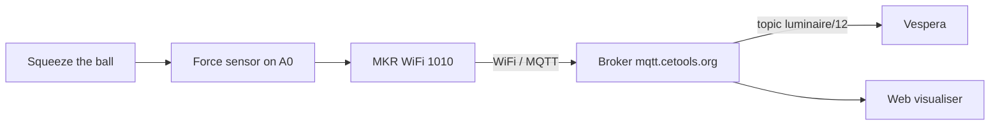
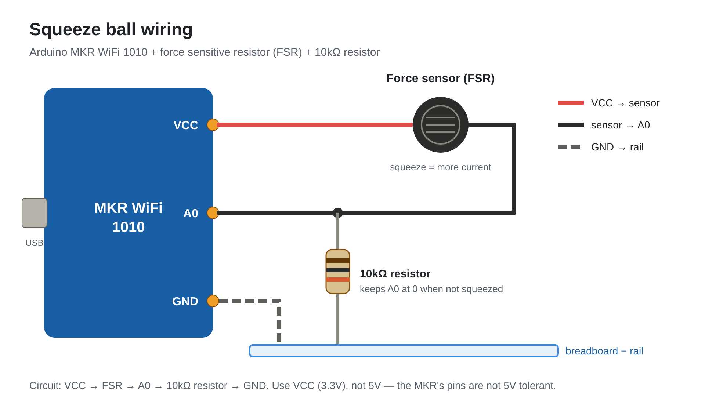

# Stress Ball Controller for Vespera

Stress often goes unseen, but its reach is vast: 74% of UK adults report feeling so stressed in the past year that they felt overwhelmed or unable to cope (Priory Group, 2026). 

My project is based on a stress ball interface, to be used by participants who are seeking a visual representation of their stress levels. The Vespera will change colour based upon how hard the stress ball is squeezed. I seek to measure how “close to boiling point” they are. 

light blue = calm, purple = building tension, red = high stress.

  <video src="https://github.com/user-attachments/assets/PASTE-YOUR-VIDEO-LINK-HERE" width="300" controls></video>

<em>Vespera reacting to the squeeze ball (light 12)</em>

## How it works
Squeezing the stress ball -> changes the sensor reading -> MKR WiFi 1010 (turns the squeeze into a colour and number of columns) -> WiFi -> MQTT broker (mqtt.cetools.org, topic 12) -> Vespera (light blue = soft, red = hard)

## Which light is mine
Light 12 - topic `student/CASA0014/luminaire/12`

## What the colours mean

| Squeeze | Colour | Meaning | Columns lit |
|---|---|---|---|
| None | Off | Released / relaxed | 0 |
| Soft | Light blue | Calm | 1–3 |
| Medium | Purple | Tension building | about 6 |
| Hard | Red | High stress | all 12 |

The harder the ball is squeezed, the more of Vespera's 12 columns light up and the brighter the colour gets. Letting go will turn off Vespera.

## Hardware
- Arduino MKR WiFi 1010
- Force sensitive resistor (FSR)
- 10kΩ resistor
- Jumper wires (2 male-to-female, 1 male-to-male)
- Breadboard
- 3.7V 2000mAh LiPo battery

## Wiring
| Part | Connects to |
|---|---|
| FSR leg 1 (red wire) | VCC |
| FSR leg 2 (black wire) | A0 |
| 10kΩ resistor | A0 → GND (blue rail) |
| Ground wire | GND → blue rail |

*Wiring from above POV*

## Repository contents
- `squeeze_ball_vespera/` - main Arduino code
- `test-sketches/sensor_test/` - first sensor test (Serial Plotter)
- `test-sketches/squeeze_ball_light/` - practice light using the onboard LED
- `images/` - photos and videos

## Testing log
- **30 Oct – Sensor test:** Serial Plotter showed about 2–3 at rest and up to ~900 on a hard squeeze.
- **1 Nov – Practice light:** onboard LED gets brighter the harder the sensor was squeezed (readings under 20 ignored).
- **2 Nov – Web visualiser:** grid filled light blue → purple → red as the squeeze got harder; blank at rest.
- **2 Nov – Battery:** board ran on a battery with no USB and still controlled Vespera.
- **2 Nov – Vespera:** with the selector dial on 12, Vespera reacted to the squeeze.
- **3 Nov – MQTT Explorer:** messages appeared on `student/CASA0014/luminaire/12` each time the ball was squeezed.

  
  

<em>The onboard LED gets brighter the harder the sensor is squeezed </em>

## Problems and fixes
- **High readings with no squeeze (700–950):** first suspected the black anti-static foam, but moving it did not resolve the issue. The real cause was the A0 wire not pushed in properly.
- **Grid lit up by itself:** the resistor leg and sensor wires were loose. Reseated them to resolve issue.
- **"Not connected" when uploading:** the Mac gave the board a new port. I Re-selected the port to fix issue.
- **Orange instead of red on Vespera:** the colour included a little green (40). So I reset green to 0 and redesigned the colours (light blue → purple → red) gave a true red.

| FSR sensor resting on black foam | Resistor was very loose |
| :---: | :---: |
|  |  |
   
## Limitations
- **Squeeze force is not stress:** the device shows how hard someone squeezes, does not automatically mean someone is stressed.
- **Loose connections:** jumper wires and a breadboard come loose easily many times. Soldering would make it sturdier and more durable.
- **Screen vs real LEDs:** colours looked different on Vespera than in the web visualiser. Much more prominent colour difference in Luminaire.
- **Shared server:** anyone with the class login can see or send to my topic.
- **One user at a time:** Vespera only shows the topic chosen on the selector dial.

## How to set it up yourself
1. Install the WiFiNINA and PubSubClient libraries in Arduino IDE
2. Copy `arduino_secrets_example.h`, rename it `arduino_secrets.h` and fill in your details
3. Change `lightId` to your own number and upload

## References
Priory Goup (2026) *Stress statistics and facts UK 2026*. https://www.priorygroup.com/mental-health/stress-treatment/stress-statistics

## Acknowledgements
Connection code adapted from the CASA0014 workshop sketch (mkr1010_mqtt_simple).

Programming: I used AI to help draft, streamline and troubleshoot the Arduino code, and to explain how certain parts of it worked. I then built, ran and tested every part of the code myself on the physical stress ball prototype, including how it controlled the Vespera installation.

Writing: I used AI to polish the wording, layout and readability of the GitHub README. The content itself, including the design decisions, hardware build, testing results and development journey, comes from my own hands-on work on the project.

