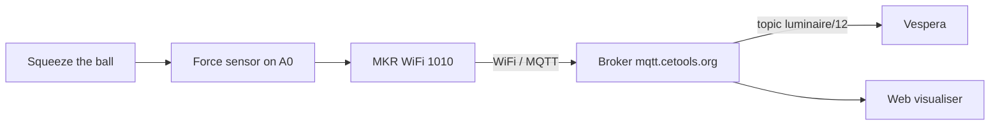

# Stress Ball Controller for Vespera

Stress often goes unseen, but its reach is vast: 74% of UK adults report feeling so stressed in the past year that they felt overwhelmed or unable to cope (Priory Group, 2026). 

My project is based on a stress ball interface, to be used by participants who are seeking a visual representation of their stress levels. The Vespera will change colour based upon how hard the stress ball is squeezed. I seek to measure how “close to boiling point” they are. 

light blue = calm, purple = building tension, red = high stress.

https://github.com/user-attachments/assets/ccb12a57-80ec-489b-a742-e1fe821bf20d

   *Vespera reacting to the squeeze ball (light 12)*

## How it works
Squeezing the stress ball -> changes the sensor reading -> MKR WiFi 1010 (turns the squeeze into a colour and number of columns) -> WiFi -> MQTT broker (mqtt.cetools.org, topic 12) -> Vespera (light blue = soft, red = hard)

## Which light is mine
Light 12 - topic `student/CASA0014/luminaire/12`

## What the colours mean

| Squeeze | Colour | Meaning | Columns lit |
|---|---|---|---|
| None | Off | Released / relaxed | 0 |
| Soft | Light blue | Calm | 1–3 |
| Medium | Purple | Tension building | about 6 |
| Hard | Red | High stress | all 12 |

The harder the ball is squeezed, the more of Vespera's 12 columns light up and the brighter the colour gets. Letting go will turn off Vespera.

## Hardware
- Arduino MKR WiFi 1010
- Force sensitive resistor (FSR)
- 10kΩ resistor
- Jumper wires (2 male-to-female, 1 male-to-male)
- Breadboard
- 3.7V 2000mAh LiPo battery

## Wiring
| Part | Connects to |
|---|---|
| FSR leg 1 (red wire) | VCC |
| FSR leg 2 (black wire) | A0 |
| 10kΩ resistor | A0 → GND (blue rail) |
| Ground wire | GND → blue rail |

## Repository contents
- `squeeze_ball_vespera/` - main Arduino code
- `test-sketches/sensor_test/` - first sensor test (Serial Plotter)
- `test-sketches/squeeze_ball_light/` - practice light using the onboard LED
- `images/` - photos and videos

## Testing log
<!-- dated entries: 30 Oct ..., 1 Nov ..., 2 Nov ... -->

## Problems and fixes
<!-- conductive foam, loose A0 wire, resistor leg, port "not connected", orange instead of red -->

## Limitations
<!-- noise threshold, loose wires, LED colours vs screen, one user at a time -->

## How to set it up yourself
1. Install the WiFiNINA and PubSubClient libraries in Arduino IDE
2. Copy `arduino_secrets_example.h`, rename it `arduino_secrets.h` and fill in your details
3. Change `lightId` to your own number and upload

## Acknowledgements
Connection code adapted from the CASA0014 workshop sketch (mkr1010_mqtt_simple).
